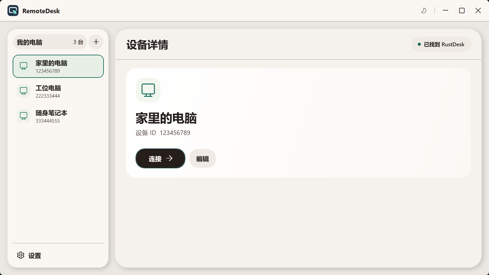

<p align="center">
  
</p>

<h1 align="center">RemoteDesk 远程桌面</h1>

<p align="center">在 Windows 上保存家里电脑的 RustDesk ID，下次点一下「连接」就能发起远程会话。</p>

<p align="center">
  <a href="https://github.com/zhengbaiyang/remote-desk/releases/latest/download/RemoteDesk.Windows-win-Setup.exe"><strong>下载 Windows x64 安装包</strong></a> ·
  <a href="#首次连接">首次连接</a> ·
  <a href="#从源码构建">从源码构建</a>
</p>



## 首次连接

准备两台电脑。**操作端**是你手边的 Windows 电脑，**目标端**是你想远程使用的那台电脑。

| 在哪台电脑上 | 做什么 |
| --- | --- |
| 目标端 | 安装并打开 RustDesk，记下首页显示的设备 ID，保持电脑唤醒。需要无人值守时，可在 RustDesk 安全设置中设置固定密码。[RustDesk 官方下载](https://github.com/rustdesk/rustdesk/releases/latest) |
| 操作端 | 安装 RustDesk，然后运行 RemoteDesk 的安装包。它已包含 .NET 运行时，安装后可以从开始菜单打开。[下载 RemoteDesk 安装包](https://github.com/zhengbaiyang/remote-desk/releases/latest/download/RemoteDesk.Windows-win-Setup.exe) |

在 RemoteDesk 的「我的电脑」里点 **添加电脑**，输入名称和目标端的设备 ID，保存后点 **连接**。首次验证在 RustDesk 会话窗口完成。以后打开 RemoteDesk，可以从左侧列表选中这台电脑并发起连接。

## 设备与连接

- **设备管理**　在左侧点「＋」保存多台电脑，按添加顺序排列。选中一台即可查看设备 ID、连接或编辑。旧版保存的单台电脑会自动出现在列表中。
- **界面外观**　点击顶部的月亮或太阳图标切换浅色与深色。程序会记住上次选择。
- **自动识别 RustDesk**　启动、返回窗口或发起连接时，程序会检查常用安装目录、Windows 安装记录、RustDesk 服务和运行中的客户端。自定义安装位置也能通过安装记录识别。设置页会显示检测到的路径；未登记且未运行的便携版可以手动指定。
- **目标端连不上**　首页的「已找到 RustDesk」表示操作端已找到客户端。请在会话窗口查看连接结果，并确认目标端已唤醒、RustDesk 正在运行。
- **使用自建服务器**　在两端的 RustDesk 中填写同一套服务配置，再回到 RemoteDesk 点击连接。[RustDesk 客户端配置](https://rustdesk.com/docs/en/self-host/client-configuration/)

设备名、设备 ID 和手动选择的程序路径保存在 `%LOCALAPPDATA%\RemoteDesk\settings.json`。密码由 RustDesk 管理。安装目录与这份配置分开存放。

## 自动更新

安装版在启动时及每隔六小时检查 GitHub 最新稳定版。发现新版后会后台下载并校验，下次启动时自动应用；也可以在「设置」中点「立即重启更新」。网络中断后可用「检查更新」重试。

**从 v0.3.1 或更早的 ZIP 版升级**：先关闭旧版，运行一次新版安装包，以后从开始菜单打开 RemoteDesk。原来保存的电脑会自动读取。

## 从源码构建

在 Windows 上安装 .NET 8 SDK，克隆仓库后，在仓库根目录打开 PowerShell。

```powershell
# 运行设备校验、配置存储和客户端启动参数检查
dotnet run --project tests/RemoteDesk.Checks/RemoteDesk.Checks.csproj -c Release

# 启动桌面程序
dotnet run --project src/RemoteDesk/RemoteDesk.csproj

# 生成 Windows x64 安装包与更新文件
.\packaging\build.ps1
```

构建产物位于 `artifacts/releases/<版本>/`。发布新版时，先递增项目文件中的 `Version` 并重新打包。把 `RemoteDesk.Windows-win-Setup.exe`、`releases.win.json` 和对应的 `*-full.nupkg` 一起上传到同一 GitHub Release，附件齐全后再将其发布为 Latest。设置里的自动更新使用这份清单。

## 项目来源

RemoteDesk 的设备管理界面使用 C# 和 WPF 实现。点击连接时，它调用本机的 `rustdesk --connect <设备ID>`。身份验证、画面传输、键鼠控制，以及 P2P 直连和中继选择，均由 RustDesk（AGPL-3.0）负责。[RustDesk 源码](https://github.com/rustdesk/rustdesk)

项目早期对 P2P 打洞与低延迟传输的调研参考了 uu-remote-study。当前发行版使用 RustDesk 建立会话。[uu-remote-study 研究项目](https://github.com/numb747/uu-remote-study)

## 开源许可

RemoteDesk 自有代码、文档和项目图标采用 [MIT 许可证](LICENSE)。安装与自动更新使用 Velopack，发行包包含其 MIT 许可声明和 .NET 运行时声明。RustDesk 作为独立安装的客户端使用，沿用上游 AGPL-3.0 许可。[Velopack 源码](https://github.com/velopack/velopack)
