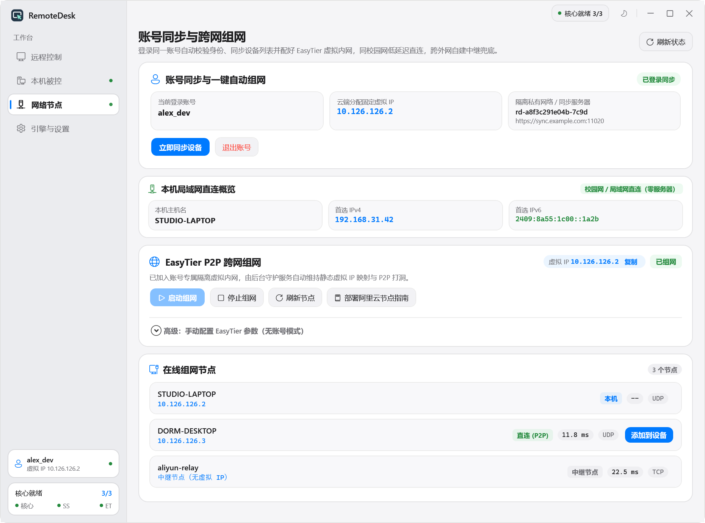
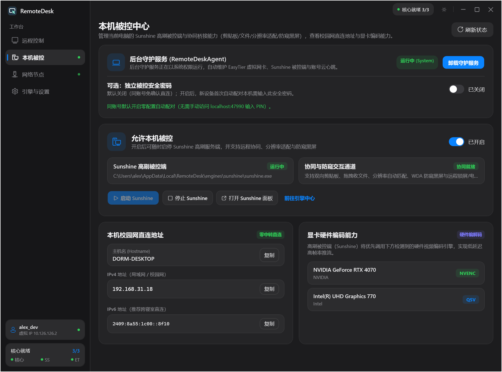
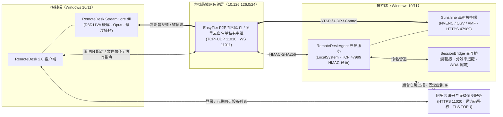

<p align="center">
  
</p>

<h1 align="center">RemoteDesk 2.1</h1>

<p align="center">
  <strong>面向 Windows 的一体化零配置高刷远程桌面平台</strong>
</p>

<p align="center">
  内置自研原生硬解控屏内核、Oink × macOS 柔和扁平桌面与微动效、全屏灵动胶囊操控栏、阿里云邀请码账号云同步与 EasyTier P2P 跨网组网，开机登录即连。
</p>

<p align="center">
  <a href="https://github.com/zhengbaiyang/remote-desk/releases/latest">
    
  </a>
  
  
  <a href="LICENSE">
    
  </a>
</p>

<p align="center">
  <a href="https://github.com/zhengbaiyang/remote-desk/releases/latest/download/RemoteDesk.Windows-win-Setup.exe"><strong>下载 Windows x64 安装包</strong></a> ·
  <a href="#核心亮点">核心亮点</a> ·
  <a href="#界面预览">界面预览</a> ·
  <a href="#系统架构">系统架构</a> ·
  <a href="#快速上手">快速上手</a> ·
  <a href="#快捷键">快捷键</a> ·
  <a href="docs/aliyun-server-guide.md">阿里云自建指南</a> ·
  <a href="#从源码构建">从源码构建</a>
</p>


---

## 为什么选择 RemoteDesk 2.1？

| 对比维度 | 传统方案（手动 Moonlight + RustDesk） | RemoteDesk 2.1 一体化平台 |
| --- | --- | --- |
| **控屏体验** | 仅作为外部启动器，另弹窗打开第三方软件 | **内置原生 `RemoteDesk.StreamCore.dll`**，连接、D3D11 硬解与键鼠音视频全在主程序内完成 |
| **操作模式** | Moonlight 默认全屏锁鼠，日常办公易迷失焦点 | **UU 远程风格 UI**：窗口/全屏随时切，顶部悬浮工具栏与「办公自由 / 游戏锁鼠」双模式 |
| **组网与配对** | 手输 IP/ID/密钥，需开浏览器输 PIN，UAC 阻塞虚拟 IP | **账号云同步 + 守护服务**：邀请码注册防蹭网，自动分配独立子网 IP 与零 PIN 静默配对 |
| **办公与防窥** | 跨网络传文件、剪贴板、分辨率适配与物理防窥割裂 | **内网安全通道一体集成**：双向剪贴板、200MB 流式快传、自适应分辨率与 WDA 防窥黑屏 |

## 核心亮点

- **内置原生高刷串流内核（`RemoteDesk.StreamCore.dll`）**
  - 基于 `moonlight-common-c` + Windows CNG（`bcrypt`）+ Media Foundation D3D11VA 零拷贝硬解（H.264 / HEVC / AV1）与 Opus / WASAPI 低延迟音频渲染。
  - 支持 1080p120、2K60、省流及自定义分辨率/帧率/码率（5–150 Mbps），会话内调节画质后自动平滑重连。
- **Oink × macOS 柔和桌面与原生微动效（v2.1 新增）**
  - 采用静谧扁平的 **柔和浅色** 默认外观与 **macOS 石墨深色** 一键切换，在 Windows 11 上支持通透 **Mica 侧栏**与原生圆角扩展。
  - 纯原生 WPF 微动效套件：侧栏与分段控件平滑滑动胶囊、卡片光标聚光描边、按钮按压回弹、在线状态点呼吸微光、页面淡入滑移，以及全屏 **Dynamic Capsule 灵动胶囊** 悬浮控制条。
- **UU 远程风格悬浮操控体验**
  - 默认以独立可缩放窗口（`1280×760`）打开，随时按 `F11` 或点击图标切换无边框全屏；全屏顶部悬浮控制条支持鼠标悬停呼出、移开自动收起。
  - **办公自由指针**（默认不锁鼠、高精度绝对坐标映射）与 **游戏相对锁定**（`WM_INPUT` 原始鼠标与系统键透传，`Ctrl+Alt` 随时释放）一键切换。
  - 集成快捷组合键（`Ctrl+Alt+Del`、`Win`、`Win+D`、`Alt+Tab`、`TaskMgr`、`Win+L`）、一键静音及可穿透点击的性能仪表盘 HUD。
- **协同办公、分辨率适配与隐私防窥**
  - **双向剪贴板**：支持文本（≤ 1 MB）与 PNG 截图（≤ 8 MB）双向实时同步，自动抑制回声循环。
  - **文件快传**：向控屏窗口直接拖拽文件或点击「传文件」，经账号 HMAC-SHA256 签名通道流式传输至被控端 `下载\RemoteDesk`（单文件上限 200 MB，全量 SHA-256 校验与重名自动编号）。
  - **自适应分辨率与断开还原**：发起连接前自动适配被控端显示器模式（不写入持久注册表），断开或停止服务后自动还原原始桌面配置。
  - **物理防窥黑屏与远程电源**：基于 `WDA_EXCLUDEFROMCAPTURE` 让被控端物理屏幕显示全黑而远控画面完全清晰（被控端本地按 `Ctrl+Alt+End` 可紧急退出）；支持远程锁屏、二次确认重启与关机。
- **账号云同步 · 零配置组网与守护服务**
  - 配套零依赖 Python 同步后端（[`server/sync/`](server/sync/)）与 **邀请码注册机制**，为每个账号生成独立隔离的 EasyTier 子网名称、密钥与固定虚拟 IPv4（`10.126.126.2..254`），中继白名单彻底防蹭网。
  - 轻量 Windows 后台守护服务 **`RemoteDeskAgent`**（`LocalSystem`）：一次授权永久托管 EasyTier 虚拟网卡与 Sunshine 被控进程，解决普通权限 `等待分配 IP` 问题，支持开机未登录/锁屏在线、远程点击 UAC 与零 PIN 静默自动配对（可选被控端二次安全密码）。
- **精简引擎中心与一键热更新**
  - 收敛并统一托管 **Sunshine**（高刷被控端）与 **EasyTier**（P2P 跨网组网）两大开源核心，内置国内 HTTPS 镜像加速、离线包导入与 GitHub Release / Velopack 自动更新。

## 界面预览

<table>
  <tr>
    <td width="50%" align="center">
      <br />
      <sub><strong>账号云同步与 EasyTier P2P 跨网节点（浅色模式）</strong><br />登录后自动分配隔离虚拟子网与固定 IP，直连 / 中继延迟一目了然</sub>
    </td>
    <td width="50%" align="center">
      <br />
      <sub><strong>本机被控中心与守护协同通道（macOS 石墨深色模式）</strong><br />系统级守护服务状态、Sunshine 高刷托管、独立安全密码与硬件编码器识别</sub>
    </td>
  </tr>
</table>

## 系统架构



更多底层协议与安全细节请参考 [v2.0 架构设计文档](docs/v2-architecture.md)。

## 快速上手

### 场景 A：同校园网 / 同局域网（零服务器直连）

1. 在控制端与被控端安装最新版 [RemoteDesk 安装包](https://github.com/zhengbaiyang/remote-desk/releases/latest/download/RemoteDesk.Windows-win-Setup.exe)。
2. 在被控端打开 **「本机被控」**，确保 Sunshine 已通过「引擎与设置」安装并启动，复制本机显示校园网 IPv4 或 IPv6 地址（首次可用 **配对设备 (Pair)** 完成 Sunshine PIN 配对）。
3. 在控制端 **「远程控制 -> + 添加」** 填入目标 IP，点击 **「发起高刷连接」** 即可。

### 场景 B：跨网全自动账号云同步（推荐 · 阿里云 3 分钟开服）

1. **一行命令部署阿里云服务端**（支持 Ubuntu / Alibaba Cloud Linux，详解见 [阿里云自建节点指南](docs/aliyun-server-guide.md)）：
   ```bash
   git clone https://github.com/zhengbaiyang/remote-desk.git
   cd remote-desk
   bash server/deploy.sh
   ```
   并在阿里云控制台安全组放行入方向端口：

   | 端口 | 协议 | 用途说明 |
   | --- | --- | --- |
   | `11020` | `TCP` | 账号注册/登录、设备云同步与隔离密钥下发（HTTPS） |
   | `11010` | `TCP + UDP` | EasyTier P2P 节点发现、打洞与私有中继主端口 |
   | `11011` | `TCP` | EasyTier WebSocket 备用通道（严格校园网兜底） |

2. **客户端注册与后台守护初始化**：
   - 在 **「网络节点」** 输入同步服务器地址（`https://<服务器公网IP>:11020`）与部署脚本输出的邀请码注册/登录。
   - 点击一次 **「启用后台守护服务」**（仅首日授权一次 UAC），软件会自动在后台安装并启动 EasyTier / Sunshine（如需被控请打开 **「本机被控 -> 允许本机被控」**）。
3. **多设备自动发现与免密直连**：
   - 其余电脑使用同一账号密码登录后会自动出现在 **「我的设备」** 列表中，选择在线设备直接点击 **「发起高刷连接」** 即可完成静默安全配对并进入远控。

## 快捷键

| 快捷键 / 入口 | 作用说明 |
| --- | --- |
| `F11` / 工具栏「全屏」 | 在可缩放窗口（`1280×760`）与无边框全屏之间快速切换 |
| `Ctrl + Alt` | 处于「游戏锁定」相对鼠标模式时，立即释放鼠标并退出锁定 |
| `Ctrl + Alt + End` | 被控端开启「物理防窥黑屏」后，在被控端本地键盘按此组合键紧急退出黑屏 |
| 顶部悬浮条「热键/电源」 | 发送远程组合键（`Ctrl+Alt+Del`、`Win`、`Win+D`、`Alt+Tab`、`TaskMgr`、`Win+L`）及锁屏 / 二次确认重启关机 |
| 拖放文件至远控画面 / 「传文件」 | 将本机文件高速发送至被控端 `下载\RemoteDesk` 目录（单文件上限 200 MB） |

## 从源码构建

### 1. 仅编译 Windows 客户端（最快）

仓库已包含预编译好的 [RemoteDesk.StreamCore.dll](src/RemoteDesk/Native/RemoteDesk.StreamCore.dll)，安装 **.NET 8 SDK** 后即可直接编译、运行全套检查或打包安装包：

```powershell
# 编译 Release 客户端
dotnet build src/RemoteDesk/RemoteDesk.csproj -c Release

# 运行核心、组网、同步、原生协议与协同检查套件
dotnet run --project tests/RemoteDesk.Checks/RemoteDesk.Checks.csproj -c Release

# 运行同步服务端单元测试（需要 Python 3.12+）
python -m unittest discover -s server/sync -p "test_*.py" -v

# 生成 Windows x64 安装包与 Velopack 更新文件（输出至 artifacts/releases/2.1.0）
.\packaging\build.ps1
```

### 2. 从头重新编译 C++ 原生串流内核（可选）

若修改了 [`src/RemoteDesk.StreamCore/`](src/RemoteDesk.StreamCore/) 原生代码，请安装 **Visual Studio 2022 Build Tools（C++ 桌面工作负载，含 CMake / Ninja）** 后执行：

```powershell
# 1. 拉取第三方原生依赖（third_party/moonlight-common-c 与 opus）
.\native\fetch_deps.ps1

# 2. 编译并自动更新 src/RemoteDesk/Native/RemoteDesk.StreamCore.dll
.\native\build_streamcore.ps1
```

## 开源许可与致谢

本项目自 v2.0.0 起以 **GNU General Public License v3.0 (GPL-3.0)** 开源协议发布，完整条款见 [LICENSE](LICENSE)。

| 关键依赖组件 | 在本项目中的用途 | 开源协议 |
| --- | --- | --- |
| `moonlight-common-c` | 内置 GameStream / Sunshine 串流控制与加密协议核心 | GPL-3.0 |
| `Sunshine` | 被控端高刷桌面捕获与硬件编码服务端 | GPL-3.0 |
| `EasyTier` | 去中心化 P2P NAT 穿透与私有中继虚拟组网引擎 | Apache-2.0 |
| `Opus` | 远控低延迟音频流解码库 | 3-Clause BSD |
| `Velopack` | Windows 客户端安装包与增量热更新框架 | MIT |
